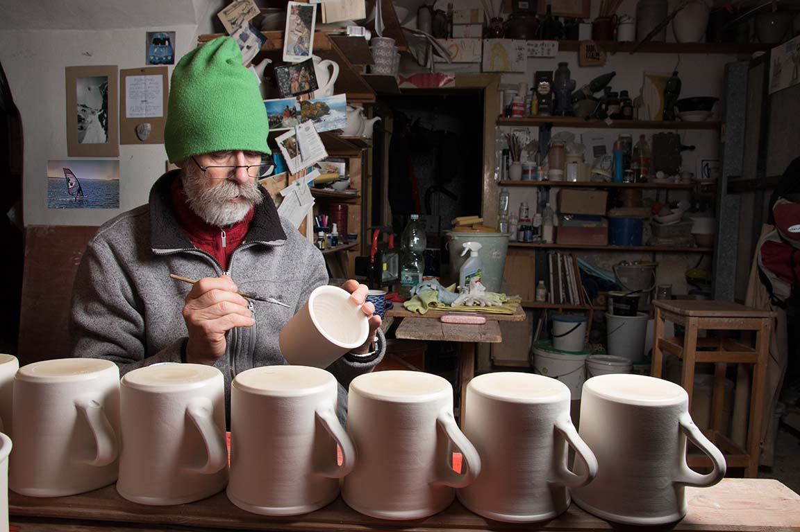
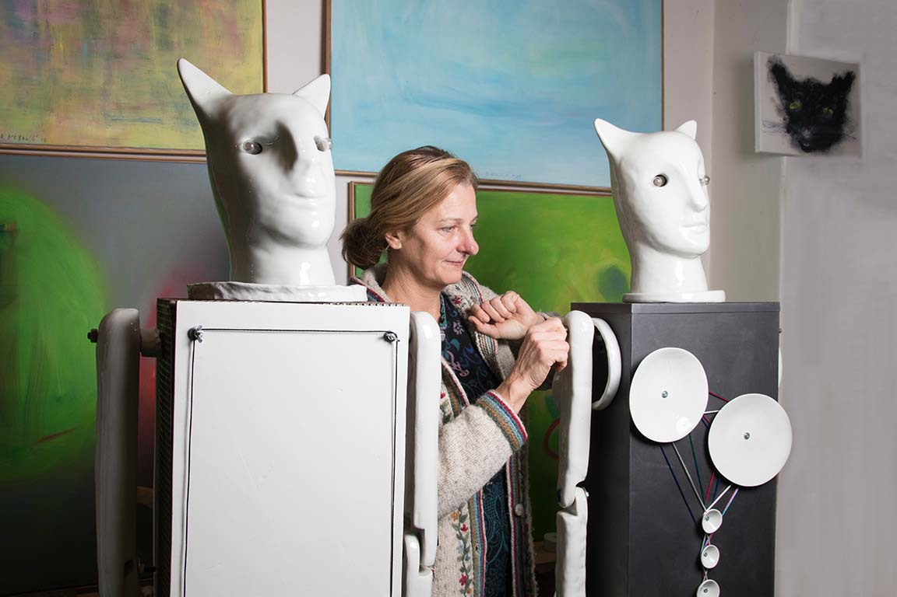

Naše nádobí je vytvářené neobvyklým způsobem točením na hrnčířském kruhu. Pro porcelán je to zcela unikátní způsob výroby. Každý kus je 100% originál.  
Porcelán je nejkvalitnější druh keramiky. Pečlivé zpracování prvotřídních surovin ze kterých je připravován na takzvaný druhý výpal ve vysoké teplotě až 1380 °C. Poskytuje vlastnosti, které nejsou u jiných keramických výrobků dosažitelné. Vyniká mechanickou pevností, bělostí, čistotou a slinutostí-zeskelněním. Jeho jedinečnost je jak v masivním tak v tenkostěnném provedení. Obvykle je pokryt tvrdou zdravotně nezávadnou, průsvitnou glazurou. Náš modrobílý porcelán je dekorován kobaltem, technikou tzv. podglazuru, nebo do glazury. Je to způsob, který zaručuje nestíratelnost dekoru používáním, protože je vypalován současně s vlastním porcelánem a glazurou na vysokou teplotu. Tyto výrobky je možné používat v mikrovlnné troubě a v myčce.

#### MARTIN

Narodil jsem se roku 1959 v Hradci Králové. Oba mí rodičové, povoláním keramici, mne vedli k lásce k tomuto povolání už jako dítě školou povinné. O prázdninách jsem docházel do hrnčířské dílny v Týništi nad Orlicí, kde jsem se později i vyučil hrnčířem. Následně jsem absolvoval SPŠK v Bechyni stejně jako mí rodičové, a dokonce i můj děda.

Po maturitě jsem pracoval v Družstvu Umělecké Výroby Keramo Praha a od roku 1987 jsem začal tvořit samostatně. Mým cílem bylo vždy vyrábět co možná nejdokonaleji  řemeslně vyrobené zboží, za které by mne pochválil můj děda i jiní staří mistři, které jsem poznal v učení I na různých hrnčířských soutěžích.

Časem jsem se naučil točit na hrnčířském kruhu i z porcelánu a po poznání jeho velkých kvalit a předností, oproti klasické keramice, jsem se už ke keramice nevrátil. Již přes 25 let  tak pracuji jenom s porcelánem. Poznal jsem, že porcelán je velmi náročný na zpracování, avšak výrobky z tohoto materiálu jsou velmi kvalitní, doslova hodny královské tabule.

Zboží které vyrábím si lidé nekupují proto, že ho nutně potřebují k životu, ale hlavně proto, že se jim líbí a pravidelným užíváním poznali jeho kvalitu. Tato skutečnost mne těší a je mi motorem se stále zlepšovat a vyrábět stále kvalitnější a oku milejší zboží. Stále je co se učit a stále je prostor pro zdokonalení.

#### DANIELA

Narodila jsem se v Bratislavě. Od dětství mě bavilo kreslení a modelování. Ve svém rodném městě jsem také vystudovala keramiku na střední škole uměleckého průmyslu, a poté jsem pokračovala na pražské UMPRUM. Za zásadní ve svém uměleckém vzdělání považuji sochařskou a keramickou praxi v ateliéru Andreje Rudavského a praxi v porcelánových fabrikách v Dubí a Duchcově.

Největší inspirací je pro mne porcelán, protože je ve svém oboru takový “Rolls Royce”. Jedná se o materiál velmi něžný, citlivý a především krásný. Práce s ním je sice technologicky velice náročná, ale poskytuje řadu možností, jak v oblasti tvarování, tak i dekorování.

Při dekorování používám různé technologie, jak podglazurové vypalované na 1390 stupňů Celsia, vtavné vypalované na 1250 stupňů, tak i naglazurové včetně zlacení (výpal na 800 stupňů). Tato tvorba je jednou z nejúžasnějších činností, které v živote mohu dělat. Jsem za to velmi vděčná.

S mou prací se mimo jiné můžete setkat ve sbírkách Uměleckoprůmyslového muzea v Praze, Jihočeské Alšově galerii, ve Slovenském centru designu v Bratislavě, v muzeu Darney ve Francii, v Porwoo ve Finsku a v mnohých soukromých sbírkách u nás i v zahraničí.
